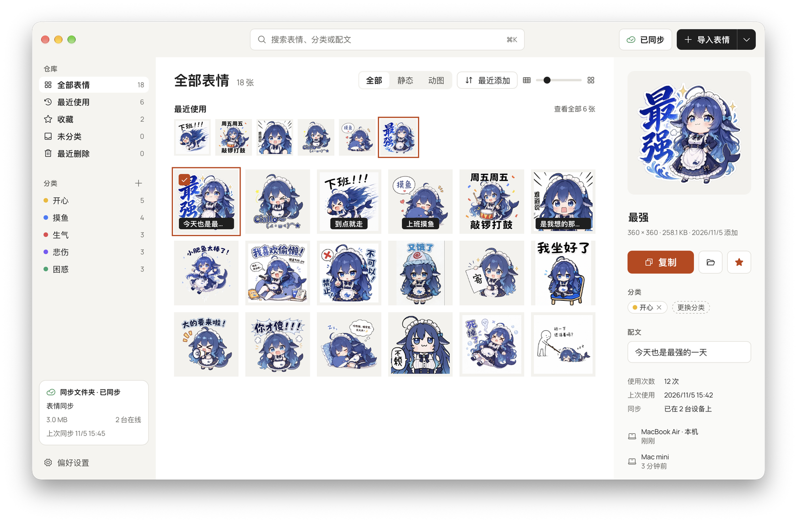

<div align="center">


# 表情管理器

macOS 和 Windows 上的表情包管理器，把表情收进一个仓库，分类整理，用的时候随手就能取。

[](https://github.com/wjiajian/sticker-manager/releases/latest)


[](LICENSE)
<a href="https://linux.do" alt="LINUX DO"></a>

[官网](https://wjiajian.github.io/sticker-manager/) · [下载](https://github.com/wjiajian/sticker-manager/releases/latest) · [使用文档](https://wjiajian.github.io/sticker-manager/docs/) · [开发者篇](#开发者篇) · [更新记录](CHANGELOG.md)

</div>

<picture>
  <source media="(prefers-color-scheme: dark)" srcset="docs/images/main-window-dark.png">
  
</picture>

表情包散落在聊天记录、下载文件夹和各种相册里，想用的时候要翻半天。表情管理器是一个个人桌面应用：所有表情放进一个本地仓库，按分类、名称和配文来找；在任何应用里按一下快捷键呼出表情面板，单击复制或者直接拖出去发送。有多台电脑的话，可以通过自己的网盘或云存储同步，不需要服务器。

<table>
<tr>
<td width="300"></td>
<td>

- **随手取用**：在任何应用里按 `⌃⌥E`（Windows 是 `Ctrl+Alt+E`）或者单击悬浮球呼出表情面板，直接输入就能搜索，单击复制，也可以拖进聊天窗口。
- **发出去的是原图**：支持 PNG、JPG、WebP、GIF、APNG，复制和拖出时保留原来的格式、透明背景和动画。
- **整理省事**：每张表情归到一个分类，还可以写配文、点收藏。导入文件夹时按文件夹名自动分类，同一张图只存一份。
- **删错了能找回**：删除的表情在「最近删除」里保留 30 天。
- **同步用自己的存储**：支持同步文件夹（iCloud 云盘、Dropbox 等）、WebDAV、Cloudflare R2 和 S3 兼容存储。
- **浅色和深色**：默认跟随系统，也可以固定一种，主窗口、表情面板和悬浮球一起切换。

</td>
</tr>
</table>

<sub>截图和录屏来自 macOS 版。</sub>

## 使用文档

安装和使用说明都在[官网](https://wjiajian.github.io/sticker-manager/docs/)上：

- [安装](https://wjiajian.github.io/sticker-manager/docs/)：下载哪个文件，第一次打开时怎样放行
- [快速上手](https://wjiajian.github.io/sticker-manager/docs/quick-start/)：导入表情，呼出表情面板
- 功能：[导入](https://wjiajian.github.io/sticker-manager/docs/import/) · [分类和整理](https://wjiajian.github.io/sticker-manager/docs/organize/) · [表情面板](https://wjiajian.github.io/sticker-manager/docs/panel/) · [悬浮球和托盘](https://wjiajian.github.io/sticker-manager/docs/floating-ball/) · [偏好设置](https://wjiajian.github.io/sticker-manager/docs/preferences/) · [同步](https://wjiajian.github.io/sticker-manager/docs/sync/) · [检查更新](https://wjiajian.github.io/sticker-manager/docs/updates/)
- [数据和备份](https://wjiajian.github.io/sticker-manager/docs/data/)：表情存在哪里，怎样备份和恢复
- [常见问题](https://wjiajian.github.io/sticker-manager/docs/faq/)：打不开、同步提示等问题

## 开发者篇

### 技术栈

[Tauri 2](https://tauri.app/) 应用。核心逻辑是不依赖 Tauri 的 Rust 库 `crates/core`（crate 名 `sticker-core`），`src-tauri` 是桌面壳，界面用 React + TypeScript + Vite + Tailwind CSS v4，元数据存在 SQLite 里，只由 Rust 读写。完整选型和实现说明见 [docs/tech-stack.md](docs/tech-stack.md)。

前端是多入口的 Vite 应用，每个窗口一个 HTML 入口：

| 入口 | 窗口 | 代码 |
|---|---|---|
| `frontend/index.html` | 主窗口 | `frontend/src/windows/main/` |
| `frontend/panel.html` | 表情面板 | `frontend/src/windows/panel/` |
| `frontend/ball.html` | 悬浮球 | `frontend/src/windows/ball/` |
| `frontend/preview.html` | 悬停预览 | `frontend/src/windows/preview/` |

每个窗口能调用哪些 Tauri 命令，由 `src-tauri/permissions/` 里的白名单决定（`main.toml`、`panel.toml`、`ball.toml`、`preview.toml`），再由 `src-tauri/capabilities/*.json` 授予对应窗口。名单之外的命令会在运行时被 Tauri 拒绝，构建和测试都发现不了，所以**新增命令时要同时加进用到它的窗口的名单**。

### 目录结构

```text
.
├── frontend/                    前端：依赖和 Vite、TypeScript 配置都在这里
│   ├── index.html, panel.html, ball.html, preview.html   各窗口入口
│   └── src/
│       ├── windows/{main,panel,ball,preview}/   各窗口的 React 代码
│       ├── components/                          通用组件
│       ├── lib/                                 IPC 封装、查询、平台判断等
│       ├── stores/                              Zustand 状态
│       └── styles/global.css                    主题变量（浅色和深色）
├── crates/core/                 sticker-core：核心逻辑
│   └── src/
│       ├── import.rs, import/   导入（文件、文件夹、zip）
│       ├── library.rs           打开仓库、列出表情
│       ├── organization.rs      分类、改名、配文
│       ├── usage.rs             使用记录、收藏
│       ├── search.rs            搜索
│       ├── deletion.rs          最近删除和彻底删除
│       ├── sync/                同步：存储接口、目录树、操作日志、合并
│       └── migrations/          SQLite 迁移
├── src-tauri/                   Tauri 桌面壳
│   ├── src/                     命令、窗口、托盘、悬浮球、面板、更新等
│   ├── permissions/             各窗口的命令白名单
│   ├── capabilities/            把权限授予各窗口
│   ├── icons/                   应用和托盘图标
│   └── tauri.conf.json, tauri.windows.conf.json
├── design/README.md             界面设计规范
├── docs/                        开发文档（见下表）和 README 配图
├── website/                     官网和使用文档（Astro + Starlight），依赖独立
└── .github/                     构建、发布和官网部署的 workflow，更新清单脚本
```

| 文档 | 内容 |
|---|---|
| [docs/tech-stack.md](docs/tech-stack.md) | 技术选型，以及仓库、剪贴板、同步、外观等的实现说明 |
| [docs/GLOSSARY.md](docs/GLOSSARY.md) | 术语表，界面文案和讨论都按它来 |
| [docs/adr/](docs/adr/) | 关键取舍的理由，包括同步格式和合并规则 |
| [docs/testing.md](docs/testing.md) | 提交前检查、网络同步的集成测试、真实窗口测试 |
| [docs/packaging.md](docs/packaging.md) | 本地打包、发布流程、更新签名、试运行发布版 |
| [docs/windows-validation.md](docs/windows-validation.md) | Windows 上验收过什么，还有什么没验 |
| [design/README.md](design/README.md) | 界面设计规范 |
| [website/README.md](website/README.md) | 官网的开发和部署 |

### 本地开发

环境要求：

- macOS 14 及以上，装好 Xcode 命令行工具；或 Windows x64，装好 Rust MSVC 工具链、C++ Build Tools、Windows SDK 和 WebView2 Runtime
- Rust stable（workspace 使用 edition 2024）
- Node.js（CI 用 22）
- pnpm 11（`frontend/package.json` 的 `packageManager` 固定为 `pnpm@11.22.0`）

前端依赖和脚本都在 `frontend/` 里，命令在仓库根目录运行：

```bash
pnpm --dir frontend install
```

```bash
STICKER_LIBRARY_DIR="$(mktemp -d)" pnpm --dir frontend tauri dev
```

`tauri dev` 先在 1420 端口启动 Vite，再编译并启动应用。前端改动热更新，Rust 改动自动重新编译。

> [!WARNING]
> 不设 `STICKER_LIBRARY_DIR` 时，开发构建打开的是真实仓库（位置见[数据和备份](https://wjiajian.github.io/sticker-manager/docs/data/)）。调试和测试请一律指向临时目录。

只在开发构建里生效的环境变量，发布版全部忽略：

| 变量 | 作用 |
|---|---|
| `STICKER_LIBRARY_DIR` | 仓库目录。必须是绝对路径，相对路径会报启动错误；目录不存在时自动新建 |
| `STICKER_UPDATE_ENDPOINT` | 改从指定的 `latest.json` 地址检查更新，并打开自动检查；开发构建只下载和校验签名，不安装 |
| `STICKER_FORCE_METERED=1` | 把当前网络当作按流量计费，用来测试自动暂停同步 |

发布版不认 `STICKER_LIBRARY_DIR`，试运行打包版时怎样隔离见 [docs/packaging.md](docs/packaging.md#试运行发布版)。

### 提交前检查

```bash
cargo fmt --all --check
cargo clippy --workspace --all-targets -- -D warnings
cargo test --workspace
pnpm --dir frontend typecheck
pnpm --dir frontend build
pnpm --dir website build
git diff --check
```

应用代码没有自动触发的 CI，这些检查要在本地跑。WebDAV 和 S3 的集成测试默认忽略，需要本机容器，跑法见 [docs/testing.md](docs/testing.md)。

### 发布

每个版本开一个短期的 `release/*` 分支，只放版本号、更新记录、阻塞发布的修复和最后的验证。macOS 和 Windows 各有一个手动触发的构建 workflow，勾选 `release` 才会发布到 GitHub Release。完整步骤见 [docs/packaging.md](docs/packaging.md#发布流程)。

### 贡献

- 界面文案和讨论使用 [GLOSSARY.md](docs/GLOSSARY.md) 里的术语。
- PR 标题用约定式提交格式，标题和描述用英文，模板见 [PULL_REQUEST_TEMPLATE.md](.github/PULL_REQUEST_TEMPLATE.md)。
- 真实窗口测试的规矩（临时仓库、不改系统设置、尽量不抢前台）和其余约定见 [AGENTS.md](AGENTS.md)。
