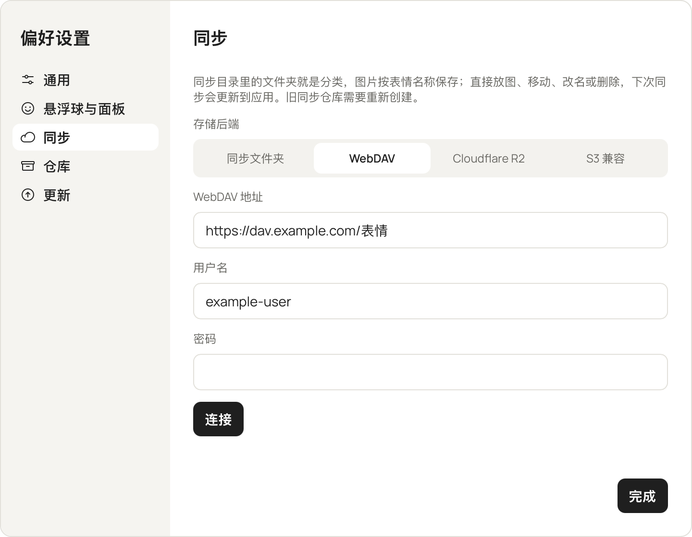
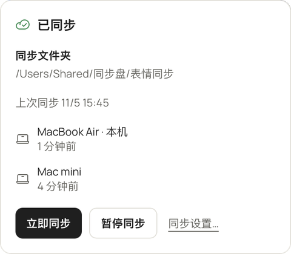

在「偏好设置 › 同步」里选一种存储后端，其他电脑选同一个位置就会合并。没有自建服务器，也不经过任何第三方服务，数据只放在你自己选的存储里。

## 存储后端

| 存储后端 | 需要填写 |
|---|---|
| 同步文件夹 | 选一个放在 iCloud 云盘、Dropbox 等同步盘里的文件夹，由同步盘在电脑之间传文件 |
| WebDAV | 地址、用户名、密码 |
| Cloudflare R2 | Account ID、Bucket、路径（可选）、Access Key ID、Secret Access Key |
| S3 兼容存储 | Endpoint、Region、Bucket、路径（可选）、Access Key ID、Secret Access Key |

## 第一次设置

要选一个空的位置，或者一个已经存在的同步仓库。连到已有仓库时会显示里面有几台设备、几张表情，确认后加入。网络后端连接时会先检查读、写、删除权限。

<small>截图来自 macOS 版</small>

## 远端的文件夹

远端是按分类排好的文件夹树：每个分类是一个文件夹，未分类的图片放在根目录，文件名就是表情名称。

你可以直接在网盘里建文件夹、放图、移动、改名或删除，下次同步时应用会把这些变化收进来，新建的文件夹会变成分类。

- 分类只认一层，更深的子文件夹不导入。
- 图片只认 png、jpg、jpeg、gif、webp。
- 根目录下的 `.sticker-manager/` 是应用的元数据目录，不要手动改动。

## 会同步什么

**会同步**：表情、分类、收藏、配文、使用记录（各设备的使用次数相加）。

**不会同步**：外观、悬浮球、快捷键、开机自启和同步配置，这些只属于本机。

## 什么时候同步

- 本机有改动后，10 秒内没有新改动就推送。
- 每 5 分钟拉取一次。
- 启动、电脑从睡眠中醒来、手动点「立即同步」时各同步一次。

同步状态显示在标题栏和左栏的同步卡片上，点开可以看进度、错误和设备列表。

<small>截图来自 macOS 版</small>

## 暂停

可以手动暂停，重启后仍然保持暂停。点「继续同步」立即同步一轮。

使用 WebDAV、R2 或 S3 时，系统标记为按流量计费或低数据模式的网络下会自动暂停自动同步，这时仍然可以手动「立即同步」。这个行为可以在同步设置里关掉。

## 凭据和隐私

密码和密钥以明文保存在本机仓库的 `local/credentials.json`，只有当前用户能读，不会同步，也不进设置文件。

:::caution
同步内容没有端到端加密，存储服务能看到你的原图。
:::
